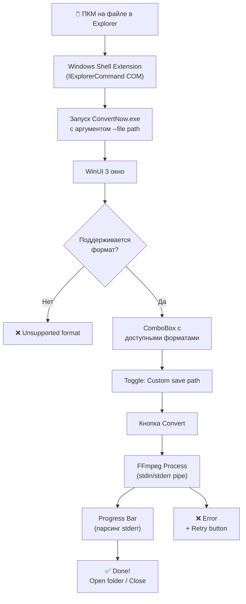
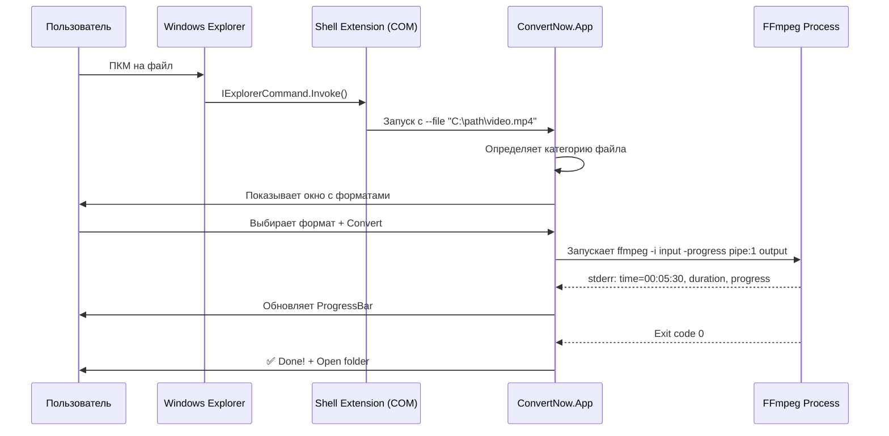
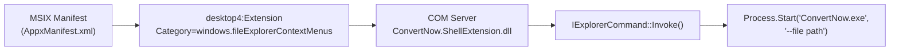

# Convert.Now — Полный план и документация

> Универсальный файловый конвертер для Windows 10/11 с интеграцией в контекстное меню Проводника.

---

## 1. Обзор проекта

| Параметр | Значение |
|---|---|
| **Название** | Convert.Now |
| **Платформа** | Windows 10 (1809+) / Windows 11 |
| **Язык** | C# (.NET 8+) |
| **UI фреймворк** | WinUI 3 (Windows App SDK 1.5+) |
| **Движок конвертации** | FFmpeg 7.x (bundled) |
| **Упаковка** | MSIX (sparse package) |
| **Язык интерфейса** | Английский |
| **Ожидаемый размер** | ~90-100 MB (с FFmpeg) |
| **RAM в idle** | ~15-25 MB |

---

## 2. Архитектура



### 2.1. Компоненты

| Компонент | Проект (Solution) | Описание |
|---|---|---|
| **ConvertNow.App** | WinUI 3 Application | Главное окно конвертации |
| **ConvertNow.ShellExtension** | COM DLL (C#/C++) | IExplorerCommand для контекстного меню |
| **ConvertNow.Core** | Class Library | Логика конвертации, FFmpeg wrapper, матрица форматов |
| **ConvertNow.Package** | MSIX Packaging | Sparse MSIX пакет + манифест |

### 2.2. Поток данных



---

## 3. Матрица конвертации форматов

### 3.1. Поддерживаемые входные форматы

| Категория | Расширения |
|---|---|
| **🎥 Видео** | `.mp4`, `.avi`, `.mkv`, `.mov`, `.webm`, `.flv`, `.wmv`, `.m4v`, `.3gp`, `.ts`, `.mpg`, `.mpeg`, `.vob`, `.ogv` |
| **🎧 Аудио** | `.mp3`, `.wav`, `.flac`, `.aac`, `.ogg`, `.wma`, `.m4a`, `.opus`, `.aiff`, `.ape`, `.ac3`, `.dts` |
| **🖼️ Изображения** | `.jpg`, `.jpeg`, `.png`, `.webp`, `.gif`, `.bmp`, `.tiff`, `.tif`, `.ico`, `.avif`, `.heic`, `.heif` |

### 3.2. Логика совместимости (что можно конвертировать → во что)

| Исходный тип → | Видео | Аудио | Изображения |
|---|:---:|:---:|:---:|
| **Видео** | ✅ mp4, avi, mkv, mov, webm, flv, wmv, m4v, 3gp, ts | ✅ mp3, wav, flac, aac, ogg, m4a, opus | ❌ |
| **Аудио** | ❌ | ✅ mp3, wav, flac, aac, ogg, m4a, opus, wma | ❌ |
| **Изображения** | ❌ | ❌ | ✅ jpg, png, webp, bmp, tiff, ico, avif |

> **Видео → Аудио** работает путём извлечения аудиодорожки (`ffmpeg -i input.mp4 -vn -acodec ... output.mp3`).
> **GIF** обрабатывается как изображение (конвертируется в статичный кадр при конвертации в jpg/png и т.д.).
> **HEIC/HEIF** требует декодер — FFmpeg с `--enable-libheif` или bundled `libheif`.

---

## 4. FFmpeg: обработка тяжёлых файлов

> FFmpeg обрабатывает файлы **потоком** (stream processing) — он **не загружает** весь файл в RAM. Файл 10 GB AVI → MP4 использует ~50-150 MB RAM вне зависимости от размера входного файла.

### 4.1. Как это работает

```
┌──────────┐     ┌──────────────┐     ┌──────────┐
│  Input   │────►│   FFmpeg     │────►│  Output  │
│  File    │     │  (streaming) │     │  File    │
│  10 GB   │     │  ~100 MB RAM │     │  ~5 GB   │
└──────────┘     └──────────────┘     └──────────┘
    Читает            Декодирует           Пишет
    по кусочкам       + кодирует           по кусочкам
```

### 4.2. Стратегия для больших файлов

| Аспект | Решение |
|---|---|
| **RAM** | FFmpeg: потоковая обработка, ~50-150 MB для любого размера файла |
| **Прогресс** | Парсинг `time=` из stderr + сравнение с `duration` → процент |
| **Отмена** | `Process.Kill()` + удаление незавершённого выходного файла |
| **Место на диске** | Проверка свободного места перед началом (предупреждение, если < размер_входного × 1.5) |
| **Длительные операции** | Предотвращение спящего режима через `SetThreadExecutionState` (Win32 API) |

### 4.3. FFmpeg команды по умолчанию (reasonable defaults)

```bash
# Видео → Видео (MP4, H.264)
ffmpeg -i input.avi -c:v libx264 -preset medium -crf 23 -c:a aac -b:a 192k output.mp4

# Видео → Аудио (извлечение дорожки)
ffmpeg -i input.mp4 -vn -c:a libmp3lame -q:a 2 output.mp3

# Аудио → Аудио
ffmpeg -i input.flac -c:a libmp3lame -q:a 2 output.mp3

# Изображение → Изображение
ffmpeg -i input.png -q:v 2 output.jpg

# С отслеживанием прогресса
ffmpeg -i input.avi -progress pipe:1 -c:v libx264 ... output.mp4
```

---

## 5. UI — Дизайн окна (MVP, без особого дизайна)

### 5.1. Состояния окна

#### State 1: Выбор формата

```
┌─────────────────────────────────────┐
│  Convert.Now                    ─ ✕ │
│                                     │
│  📄 video.mp4                       │
│  ─────────────────────────────────  │
│                                     │
│  Convert to:  [ MP4 ▾ ]            │
│                                     │
│  ☐ Custom save location            │
│                                     │
│           [ Convert ]               │
│                                     │
└─────────────────────────────────────┘
```

#### State 1b: С кастомным путём

```
┌─────────────────────────────────────┐
│  Convert.Now                    ─ ✕ │
│                                     │
│  📄 video.mp4                       │
│  ─────────────────────────────────  │
│                                     │
│  Convert to:  [ MP4 ▾ ]            │
│                                     │
│  ■ Custom save location            │
│  C:\Users\Downloads    [Browse...]  │
│                                     │
│           [ Convert ]               │
│                                     │
└─────────────────────────────────────┘
```

#### State 2: Конвертация (прогресс)

```
┌─────────────────────────────────────┐
│  Convert.Now                    ─ ✕ │
│                                     │
│  📄 video.mp4 → video.avi           │
│  ─────────────────────────────────  │
│                                     │
│  Converting...                      │
│  ████████████░░░░░░░░  62%          │
│  ETA: 2m 34s                        │
│                                     │
│           [ Cancel ]                │
│                                     │
└─────────────────────────────────────┘
```

#### State 3: Готово

```
┌─────────────────────────────────────┐
│  Convert.Now                    ─ ✕ │
│                                     │
│  ✅ Done!                           │
│  ─────────────────────────────────  │
│                                     │
│  video.avi (4.2 GB)                 │
│  Saved to: C:\Users\Videos\         │
│                                     │
│  [ Open folder ]     [ Close ]      │
│                                     │
└─────────────────────────────────────┘
```

#### State 4: Ошибка

```
┌─────────────────────────────────────┐
│  Convert.Now                    ─ ✕ │
│                                     │
│  ❌ Conversion failed               │
│  ─────────────────────────────────  │
│                                     │
│  Error: Codec not supported for     │
│  this format combination.           │
│                                     │
│  [ Retry ]           [ Close ]      │
│                                     │
└─────────────────────────────────────┘
```

#### State 5: Неподдерживаемый формат

```
┌─────────────────────────────────────┐
│  Convert.Now                    ─ ✕ │
│                                     │
│  ⚠️ Unsupported format              │
│  ─────────────────────────────────  │
│                                     │
│  The file "app.exe" cannot be       │
│  converted. Convert.Now supports    │
│  video, audio, and image files.     │
│                                     │
│              [ Close ]              │
│                                     │
└─────────────────────────────────────┘
```

### 5.2. Размер окна

| Параметр | Значение |
|---|---|
| **Ширина** | 420 px (фиксированная) |
| **Высота** | ~280-340 px (адаптивная) |
| **Resizable** | Нет |
| **Центрирование** | По центру экрана |

---

## 6. Shell Extension (контекстное меню)

### 6.1. Регистрация IExplorerCommand



### 6.2. Ключевые моменты

- **Иконка** в контекстном меню: кастомная иконка Convert.Now (16×16 / 32×32)
- **Текст**: `Convert now`
- **Видимость**: Для всех файлов (`*`), исключая папки (Directory)
- **MSIX sparse package** позволяет регистрацию без Microsoft Store

---

## 7. Именование выходного файла

```
Входной: video.mp4
Выходной (нет конфликта): video.avi
Выходной (конфликт):      video (1).avi
Выходной (2-й конфликт):  video (2).avi
```

> Логика: проверяем `File.Exists()`, если да — инкрементируем суффикс `(N)`.

---

## 8. Структура Solution

```
ConvertNow/
├── ConvertNow.sln
├── src/
│   ├── ConvertNow.App/                    # WinUI 3 приложение
│   │   ├── App.xaml / App.xaml.cs
│   │   ├── MainWindow.xaml / .cs          # Главное окно
│   │   ├── ViewModels/
│   │   │   └── MainViewModel.cs           # MVVM ViewModel
│   │   ├── Converters/                    # XAML value converters
│   │   ├── Assets/
│   │   │   ├── icon.ico
│   │   │   └── context-menu-icon.ico
│   │   └── Strings/                       # Ресурсы строк (en)
│   │
│   ├── ConvertNow.Core/                   # Бизнес-логика
│   │   ├── Conversion/
│   │   │   ├── FFmpegRunner.cs            # Запуск FFmpeg, парсинг прогресса
│   │   │   ├── ConversionJob.cs           # Модель задачи конвертации
│   │   │   └── ConversionResult.cs
│   │   ├── Formats/
│   │   │   ├── FormatRegistry.cs          # Реестр всех форматов
│   │   │   ├── FormatCategory.cs          # Enum: Video, Audio, Image
│   │   │   └── FormatCompatibility.cs     # Матрица совместимости
│   │   └── FileUtils/
│   │       ├── OutputNameResolver.cs      # Логика именования (1), (2)...
│   │       └── DiskSpaceChecker.cs
│   │
│   ├── ConvertNow.ShellExtension/         # COM Shell Extension
│   │   ├── ConvertNowCommand.cs           # IExplorerCommand implementation
│   │   └── ClassFactory.cs
│   │
│   └── ConvertNow.Package/               # MSIX packaging
│       ├── AppxManifest.xml
│       ├── Assets/
│       └── mapping.txt
│
├── tools/
│   └── ffmpeg/                            # Bundled FFmpeg binaries
│       ├── ffmpeg.exe
│       └── ffprobe.exe
│
├── tests/
│   ├── ConvertNow.Core.Tests/
│   └── ConvertNow.App.Tests/
│
└── docs/
    └── PLAN.md
```

---

## 9. План реализации по этапам

### Phase 1: Скелет (1-2 дня)
- [ ] Создать Solution с 4 проектами
- [ ] Настроить WinUI 3 проект с .NET 8
- [ ] Создать `MainWindow.xaml` с базовой разметкой (ComboBox, Button, ProgressBar, ToggleSwitch)
- [ ] Реализовать аргумент `--file` и парсинг пути

### Phase 2: Движок конвертации (2-3 дня)
- [ ] Скачать и добавить FFmpeg binaries
- [ ] Реализовать `FFmpegRunner` — запуск процесса, парсинг прогресса из stderr
- [ ] Реализовать `FormatRegistry` и `FormatCompatibility` — матрица форматов
- [ ] Реализовать `OutputNameResolver` — логика суффиксов `(1)`, `(2)`
- [ ] Реализовать отмену конвертации (`Process.Kill()` + cleanup)

### Phase 3: UI логика (1-2 дня)
- [ ] MVVM: `MainViewModel` — связать UI с Core
- [ ] Состояния окна: Select → Progress → Done / Error / Unsupported
- [ ] ToggleSwitch для custom save path + FolderPicker
- [ ] ETA расчёт на основе скорости конвертации
- [ ] `SetThreadExecutionState` — предотвращение спящего режима

### Phase 4: Shell Extension (2-3 дня)
- [ ] Реализовать `IExplorerCommand` COM сервер
- [ ] Создать `AppxManifest.xml` с `fileExplorerContextMenus`
- [ ] Создать self-signed certificate для разработки
- [ ] Собрать sparse MSIX пакет
- [ ] Тестирование: контекстное меню на Win10 и Win11

### Phase 5: Тестирование и полировка (1-2 дня)
- [ ] Unit тесты для Core (форматы, совместимость, именование)
- [ ] Интеграционные тесты с FFmpeg
- [ ] Тест: файл 10+ GB
- [ ] Тест: нет места на диске
- [ ] Тест: повреждённый файл
- [ ] Тест: файл с юникодными символами в имени
- [ ] Тест: файл на сетевом диске

> **Общее время**: ~7-12 дней

---

## 10. Зависимости (NuGet)

| Пакет | Версия | Назначение |
|---|---|---|
| `Microsoft.WindowsAppSDK` | 1.5+ | WinUI 3 |
| `Microsoft.Windows.SDK.BuildTools` | 10.0.22621+ | Win32 API |
| `CommunityToolkit.Mvvm` | 8.x | MVVM (ObservableObject, RelayCommand) |
| `CommunityToolkit.WinUI.Controls` | 8.x | Дополнительные WinUI контролы |

> **Нет NuGet-обёрток для FFmpeg** (вроде Xabe.FFmpeg) — они добавляют overhead и ограничения. Вместо этого — прямой вызов `Process.Start("ffmpeg.exe", args)` с парсингом stderr. Это даёт полный контроль и минимальный вес.

---

## 11. Риски и митигации

| Риск | Вероятность | Митигация |
|---|---|---|
| HEIC/HEIF не поддерживается в стандартном FFmpeg | Средняя | Использовать FFmpeg build с `--enable-libheif`, или скачать с gyan.dev (full build) |
| Sparse MSIX требует сертификат для установки | Высокая | Self-signed cert для разработки; для дистрибуции — покупка code signing cert (~$70-200/год) или Microsoft Store |
| WinUI 3 окно медленно запускается при первом вызове | Средняя | Pre-launch (фоновый процесс) или splash optimization; для MVP — допустимые ~0.5-1s |
| Антивирус блокирует bundled FFmpeg.exe | Низкая | Code signing сертификат решает; для dev — добавить исключение |
| FFmpeg не поддерживает некоторые проприетарные кодеки | Низкая | Показать понятную ошибку; использовать full build с максимумом кодеков |

---

## 12. Будущие улучшения (post-MVP)

- 🎨 Дизайн: Fluent Design, тёмная/светлая тема, анимации
- ⚙️ Настройки качества: битрейт, разрешение, кодек
- 📋 Batch конвертация: ПКМ на нескольких файлах
- 🔄 Drag-and-drop файлов в окно
- 🌐 Мультиязычность (i18n)
- 🔔 Windows Toast уведомление по завершении
- 📊 История конвертаций
- ⬆️ Авто-обновление через MSIX
